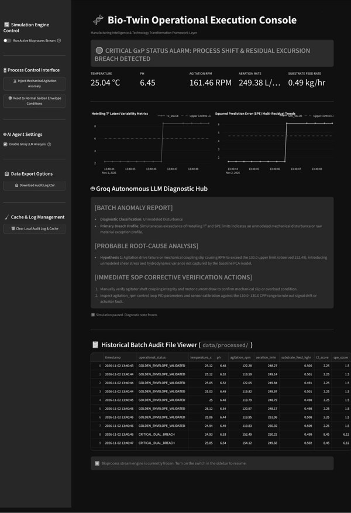
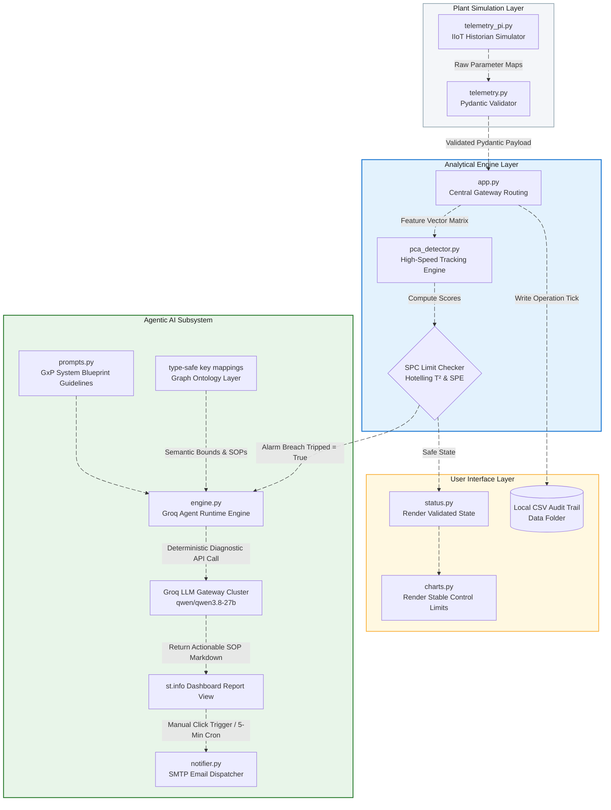
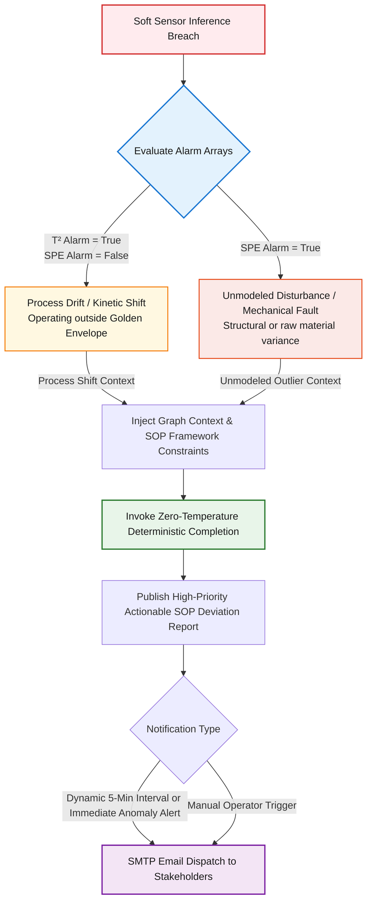

# 🧬 Bio-Twin Operational Execution Console
### Manufacturing Intelligence & Technology Transformation Framework Layer

This repository serves as a self-contained core framework for implementing advanced manufacturing intelligence, latent variable soft sensors, and agentic decision-support workflows within a biopharmaceutical manufacturing context (Pharma 4.0). 

The architecture is explicitly optimized to ingest streaming industrial internet of things (IIoT) telemetry from an in-memory historian simulator, monitor multi-variable statistical process control (MSPC) boundaries via a lightweight Principal Component Analysis (PCA) tracking matrix, and generate Standard Operating Procedure (SOP) compliant diagnostic rationales using a localized Groq LLM agent loop.

---


---

## Architecture Overview

### System Data Flow Architecture
The diagram below illustrates how raw plant data streams through the validation and statistical process control layers before reaching the low-latency agentic diagnostic engine:



### Anomaly Diagnostic Logic Flow
The Agentic Subsystem classifies multivariate breaches deterministically based on statistical projection matrices:



---

## Repository Tree

```text
bio-twin-mitt-core/
│
├── .github/
│   └── workflows/
│       └── lint-and-test.yml          # Automated PEP8 / Pytest CI verification
│
├── .streamlit/
│   ├── config.toml                    # Production UI styling, theme colors, & timeouts
│   └── secrets.toml                   # Local storage container for GROQ_API_KEY & SMTP credentials
│
├── config/
│   ├── __init__.py
│   └── base.py                        # Centralized application constants & parameter limits
│
├── data/
│   └── processed/                     # Stores local running history audit sheets
│
├── docker/
│   └── Dockerfile.app                 # Multi-stage production Streamlit web container
│
├── src/
│   ├── mitt_core/
│   │   ├── __init__.py
│   │   │
│   │   ├── agents/                    # --- Agentic AI Subsystem ---
│   │   │   ├── __init__.py
│   │   │   ├── engine.py              # Groq LLM autonomous loop manager
│   │   │   ├── prompts.py             # System prompt blueprints and SOP constraints
│   │   │   └── tools/
│   │   │       ├── __init__.py
│   │   │       └── kg_connector.py    # Local asset interface mapping logic
│   │   │
│   │   ├── domain/                    # --- Enterprise Business Logic ---
│   │   │   ├── __init__.py
│   │   │   ├── knowledge_graph.py     # Structural Bioprocess ontological bounds
│   │   │   └── telemetry.py           # Strict Pydantic models for sensor validation
│   │   │
│   │   ├── infrastructure/            # --- Plant Telemetry Simulator & Notifications ---
│   │   │   ├── __init__.py
│   │   │   ├── local_csv_exporter.py  # Local mock dataset provisioner utility
│   │   │   ├── telemetry_pi.py        # High-frequency IIoT stream simulator (Historian)
│   │   │   └── notifier.py            # SMTP notification dispatcher (Manual & 5-min intervals)
│   │   │
│   │   └── models/                    # --- Latent Variable Soft Sensors ---
│   │       ├── __init__.py
│   │       ├── pca_detector.py        # Multi-variable PCA anomaly detection engine
│   │       └── train.py               # Local historical training & tuning loops
│   │
│   └── ui/                            # --- User Interface Components ---
│       ├── __init__.py
│       └── components/
│           ├── charts.py              # Plotly statistical control limit trends
│           └── status.py              # Color-coded GxP process alarm alerts
│
├── tests/
│   ├── __init__.py
│   └── unit/                          # Core model math and schema tests
│       └── test_pca_math.py
│
├── .env.example                       # Local environment credential blueprint
├── .gitignore
├── app.py                             # Central Streamlit layout entrypoint with scheduled loops
└── requirements.txt                   # Pinned localized build packages
```

---

## Core System Architecture Breakdown

### 🤖 Agentic AI Subsystem (`src/mitt_core/agents/`)
* **`engine.py`:** Orchestrates the automated decision loop using the official `groq` SDK, executing low-latency inferences using a **30-second throttling guard** to completely eliminate token rate limits.
* **`prompts.py`:** Houses deterministic system prompt blueprints, critical alarm parsing matrices, and markdown response constraints to keep LLM outputs bounded and aligned with standard manufacturing workflows.
* **`tools/kg_connector.py`:** Bridges the AI loop with the local asset ontology, converting structured parameter boundaries into clear, descriptive plain-text context strings for the model.

### 🏭 Enterprise Domain Layer (`src/mitt_core/domain/`)
* **`knowledge_graph.py`:** Implements an in-memory semantic network mapping relationships between critical assets, equipment dependencies, Critical Process Parameters (CPPs), and Critical Quality Attributes (CQAs).
* **`telemetry.py`:** Leverages strict Pydantic schemas to validate and serialize data streams before they reach analytical or reporting engines.

### 🌐 Plant Telemetry & Communication (`src/mitt_core/infrastructure/`)
* **`telemetry_pi.py`:** Models a high-frequency plant data stream, generating normal bioprocess variables with realistic noise or active mechanical fault profiles on demand.
* **`local_csv_exporter.py`:** Standardizes mock environment setups by auto-generating a 500-row timeline CSV that maps directly to target bioprocess tag arrays.
* **`notifier.py`:** Handles external email alert operations. Supports **on-demand manual reporting via dashboard buttons** as well as a **dynamic background thread that dispatches comprehensive process summaries every 5 minutes** (or immediately if a high-priority PCA anomaly breach is registered before the timer ends).

### 📈 Soft Sensors & Machine Learning (`src/mitt_core/models/`)
* **`pca_detector.py`:** Multivariable tracking engine that calculates real-time Hotelling’s T² and Squared Prediction Error (SPE) boundaries using frozen calculation variance parameters to eliminate dynamic runtime exceptions.
* **`train.py`:** Ingests local processed reference spreadsheet documents, isolates feature columns, validates non-null row matrices, and serializes optimized parameters directly to static disk binary blocks (`.pkl`).

### 🎨 User Interface Layer (`src/ui/components/`)
* **`status.py`:** Standardizes visual alert configurations, generating color-coded warning headers depending on specific statistical alarm types and writing live data strings directly down into an offline `.csv` log.
* **`charts.py`:** Constructs high-performance, interactive, and dark-themed Plotly charts showing score trajectories against calculated statistical Upper Control Limits (UCL).

---

## Getting Started: Local Deployment Lifecycle

Follow these four terminal commands to provision data, train the models, and spin up the entire self-contained framework locally:

```bash
# 1. Install localized mathematical, layout, and inference client packages
pip install streamlit plotly numpy scipy scikit-learn pandas groq pydantic pytest black flake8

# 2. Provision the local mock timeline dataset file (500 historical rows)
python src/mitt_core/infrastructure/local_csv_exporter.py

# 3. Execute the training loop to calibrate the PCA matrix and export the pickle model
python src/mitt_core/models/train.py

# 4. Initialize the real-time operational execution console dashboard
👉 http://localhost:8506```

---

## Disclaimer

This project is a simulated biopharmaceutical manufacturing environment (Pharma 4.0) intended strictly for educational, research, and proof-of-concept demonstration purposes. It relies on synthetic IIoT telemetry and should not be used for real-world clinical production, live process control, or validated GxP decision-making without independent regulatory verification.

Users are responsible for securing their own `GROQ_API_KEY` and SMTP email credentials locally (such as within `.streamlit/secrets.toml` or `.env`), adhering to Groq API rate limits and terms of service, and ensuring that automated email notifications are only directed to authorized recipients.

---
## 🛡️ License, Copyright & Compliance Notices

**All Rights Reserved © 2026 T A Srinivas.**

> **Strict Intellectual Property Notice:** This repository is strictly for portfolio viewing and technical evaluation purposes. **DO NOT COPY, CLONE, FORK, OR REDISTRIBUTE** this source code, architecture, or documentation. Stolen copies or unauthorized forks will be reported immediately for a **GitHub DMCA copyright takedown**.

For corporate licensing, enterprise deployment, or commercial inquiries, please contact **`tasrinivass@gmail.com`**.

* **Lead Architect & Developer:** [Srinivasta](https://github.com/SRINIVASTA)

### 🌐 Let’s Connect

- [](https://www.linkedin.com/in/srinivas-t-a-557637119/)  
- [](https://www.kaggle.com/srinivasta)  
- [](mailto:tasrinivass@gmail.com)  
- [](https://github.com/srinivasta)
- [](https://srinivasta.github.io)

